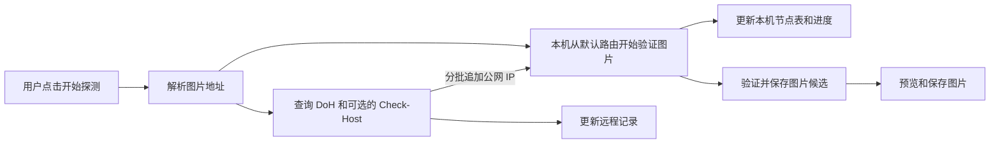

# 开发与维护

## 代码入口

- `main.go` 管理原生窗口、任务生命周期、按需预览和系统保存对话框。探测及图像解码在后台运行，窗口状态通过 `Window.Update` 批量更新。
- `interface.go` 绘制恢复页、节点表和大图查看器。`guide.go` 绘制技术与维护页。[Kumo 视觉规范](https://kumo-ui.com/skill/)
- `network.go` 解析微博详情，查询带 ECS 的 DoH，并轮询 Check-Host 的远程 HTTP 和 DNS 结果。
- `recovery.go` 验证候选节点、识别占位图，并对比采样与完整下载的内容。固定 IP 请求保留原图床域名、Host 和 TLS 验证。相同 SHA-256 共用缓存文件，各节点保留自己的来源。
- `assets/app-icon.png` 是应用图标源文件，MyGo 根据 `mygo.json` 的 `icon` 字段生成应用包内的 `AppIcon.icns`。

## 排查探测结果

| 现象 | 检查位置 |
| --- | --- |
| 微博详情解析失败 | 检查 `network.go` 的详情请求及返回字段。用同一条微博的新浪图床直链复测，确认问题是否出在详情接口。 |
| 远程探针无响应或返回 403 | 查看「远程探测」及「运行日志」。节点地址可进入本机验证，远程 HTTP 状态只反映该探针的访问结果。 |
| 节点表出现候选，预览区为空 | 查看预览区的节点错误，或查看「运行日志」里的完整下载及文件校验结果。节点表的候选状态来自响应采样。 |
| 图像内容或尺寸不符合预期 | 根据预览和节点请求详情对照图片地址、请求节点、尺寸及 CDN 版本。只有微博详情明确提供原图地址的版本才显示「微博标记原图」。 |

每轮界面探测使用独立的缓存目录，开始下一轮或正常退出时清理。命令行验证通过 `-live <图片地址> -out <目录>` 运行，输出文件保留在指定目录。可以用 `-snapshot <PNG 路径>` 渲染空闲窗口以验证布局。

本地构建产物和项目接续记录分别放在 `build/` 与 `agent-memory/`，均由 Git 忽略。提交前运行开发验证和构建命令。[开发验证](../README.md#开发验证) · [打包命令](../README.md#打包)
